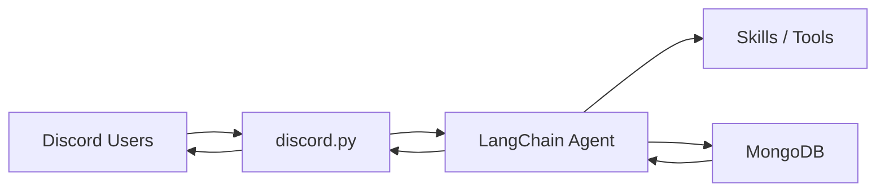

# Transit Buddy

## Project Overview

Transit Buddy is an AI-powered Discord bot designed to help university students coordinate daily campus commutes more effectively. The initial foundation is intentionally lightweight and modular so that separate contributors can build the Discord integration, database layer, and LangChain reasoning independently.

The project focuses on ASU students at the Tempe campus, while the architecture is designed to support additional universities later.

## Problem Statement

University students often have different class times, transit constraints, and departure preferences. Coordinating rides, commute partners, and timing can be difficult when schedules vary across days and students may not leave campus immediately when classes end. A bot that can interpret schedules, compare commute preferences, and negotiate shared departure plans can reduce friction and improve coordination.

## Proposed Solution

Transit Buddy combines a Discord interface, a MongoDB-backed data layer, and a LangChain-based agent with skill files. Students can upload class schedules, confirm the extracted details, and store them in a structured data model. The agent reads skill instructions, accesses schedule and preference data through shared service contracts, and generates recommendations for ride coordination, commute matching, and schedule-based availability discussions.

## Key Features

### Planned features

- Screenshot-based schedule upload
- Schedule confirmation before persistence
- Student schedule storage
- Commute matching between compatible students
- Ride-sharing coordination
- Group constraint negotiation

### Implemented in the foundation

- Project scaffolding and modular directory structure
- Shared Pydantic contracts for communication between teams
- Environment configuration handling
- Documentation for responsibilities and integration contracts
- Python Discord client with `/ask`, `/schedule upload`, and `/schedule view`
- `/schedule upload` (review a screenshot privately, then Confirm or Cancel) and `/schedule view`
- Guild slash-command registration script

## Technology Stack

- Python 3.11+: runtime environment for the bot and project scripts.
- discord.py: Discord client, command handling, and bot interactions.
- MongoDB Atlas: cloud database for student, schedule, commute, and ride data.
- PyMongo + Pydantic: MongoDB access and schema validation for persisted documents.
- LangChain (Python): orchestration for agent behavior and multimodal processing workflows.
- python-dotenv: environment variable management for local configuration.

## System Architecture



## Folder Structure

- src/__main__.py: application startup entry point (`python -m src`).
- src/config/: environment configuration loader.
- src/discord_bot/: developer-owned Discord integration layer (named to avoid shadowing the `discord` library).
- src/database/: developer-owned MongoDB models, repositories, and services.
- src/agent/: developer-owned LangChain agent and LLM workflow code.
- src/skills/: Markdown skill templates for the agent.
- src/shared/: cross-team contracts, constants, and validators.
- src/utils/: utility modules such as logging.
- docs/: architecture, responsibilities, development guide, and integration contracts.
- tests/: test scaffolding for the three contributors.
- scripts/: command registration and demo data setup scripts.

## Team Responsibilities

| Developer | Module | Branch | Responsibilities | Deliverables |
| --- | --- | --- | --- | --- |
| Developer 1 | src/discord_bot/, tests/discord/ | feature/discord-bot | Build Discord app setup, command registration, mentions, screenshot handling, confirmation flows, and message forwarding to the agent. | Discord bot client, slash commands, handlers, tests |
| Developer 2 | src/database/, tests/database/ | feature/mongodb | Create MongoDB Atlas, Pydantic/PyMongo models, repositories, validation, schedule storage, and demo data. | Database models, services, seed script, tests |
| Developer 3 | src/agent/, src/skills/, tests/agent/ | feature/langchain-agent | Configure LangChain, multimodal extraction, skill files, matching logic, and response generation. | Agent service, skills, extraction logic, tests |

## Git Branching Strategy

This project uses a shared main branch for the initial foundation. After the project is committed to main, each developer creates their own branch from main:

```bash
git checkout main
git checkout -b feature/discord-bot
git checkout -b feature/mongodb
git checkout -b feature/langchain-agent
```

The important rule is that each developer works independently on their assigned branch and keeps integration boundaries clear.

## Local Setup

### Clone the repository

```bash
git clone <repository-url>
cd transit-buddy
```

### Install dependencies

```bash
python3 -m venv .venv
source .venv/bin/activate
pip install -r requirements.txt
```

### Create environment file

```bash
cp .env.example .env
```

Then fill in the required values when the relevant service is actually being used.

### Start the application

```bash
python -m src
```

Run tests:

```bash
pytest
```

## Discord Setup

Create a Discord application, configure bot permissions, and invite it to the testing server. Set `DISCORD_TOKEN` and `DISCORD_GUILD_ID` in `.env` (and `MONGODB_URI` plus the `LLM_*` settings for the `/schedule` commands), then start the bot and register its guild commands:

```bash
python -m src
python -m scripts.register_discord_commands
```

## MongoDB Setup

Developer 2 must create a MongoDB Atlas cluster, database, and connectivity configuration, and then implement the storage layer and validation in the database module.

## LangChain Setup

Developer 3 must configure the selected LLM provider, multimodal extraction flow, and agent skill files for schedule understanding and commute reasoning.

## Integration Workflow

The integration flow is intentionally simple:

1. Discord receives user messages and screenshots.
2. The Discord layer forwards relevant data to the agent.
3. The agent loads skill instructions and uses tools to query or reason about stored information.
4. The MongoDB layer provides persisted student, schedule, and preference data.
5. Responses are sent back to the Discord user.

## MVP Scope

The minimum hackathon scope includes:

- initial project foundation and contract definitions
- Discord bot commands: `/ask`, `/schedule upload`, and `/schedule view`
- MongoDB service placeholders and data contracts
- LangChain agent skeleton and skill templates
- schedule extraction workflow from screenshots
- schedule confirmation flow
- commute recommendation logic based on user inputs

## Future Improvements

The following improvements are planned beyond the initial hackathon scope and are not implemented in this foundation:

- Live transit information
- Campus shuttle integration
- Real-time ride matching
- Multi-campus support
- Notifications and reminders

## Branch and Deployment Notes

- The initial project foundation belongs to main.
- No feature branches are created automatically.
- No GitHub push or remote changes are performed during setup.
- Secrets remain in local .env files and must never be committed.

## Responsibilities Summary

- Developer 1 owns the Discord bot and message-flow implementation.
- Developer 2 owns persistence, validation, and database operations.
- Developer 3 owns the LangChain agent, multimodal extraction, and reasoning logic.

The repository is intentionally organized to keep each developer focused on a separate domain without creating hidden dependencies.
